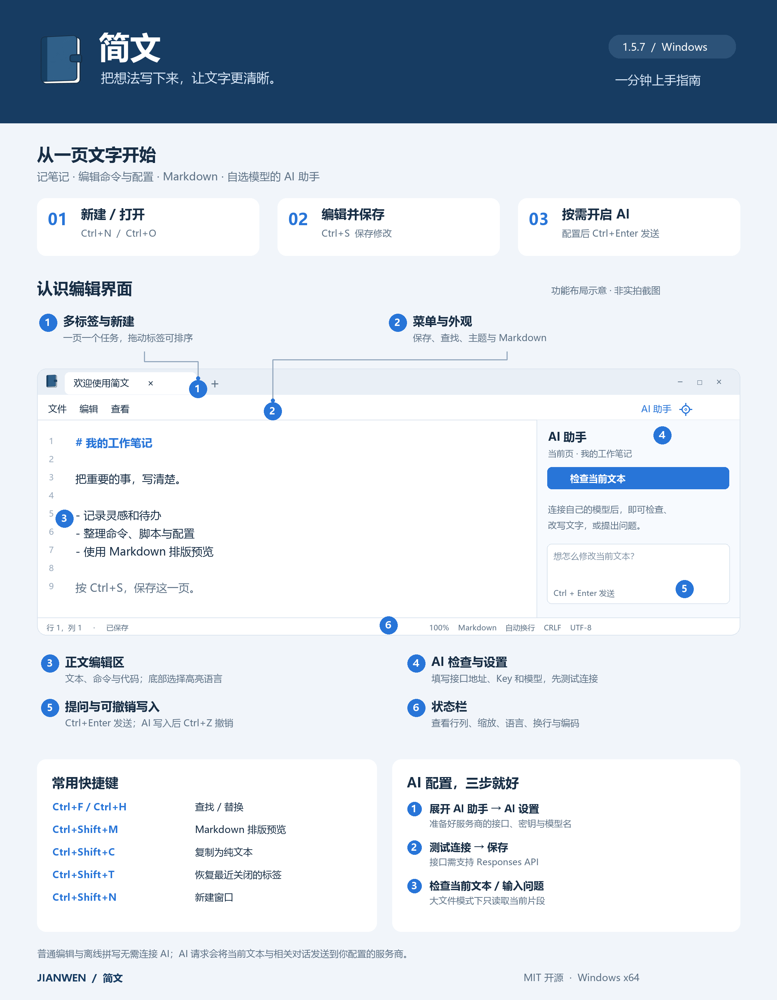

<h1 align="center">简文 Jianwen</h1>

轻量的中文 Windows 文本编辑器，让笔记、命令与 AI 写作集中在一处。

<a href="https://github.com/shencheng765/jianwen/releases/latest">下载 Windows 版</a> · <a href="docs/使用指南.md">使用指南</a> · <a href="LICENSE">MIT 开源许可</a>

## 下载与安装

到 [Releases](https://github.com/shencheng765/jianwen/releases/latest) 下载 **1.5.7**：

| 文件 | 用途 |
| --- | --- |
| Jianwen-1.5.7-Setup-x64.exe | 安装版，推荐日常使用 |
| Jianwen-1.5.7-Windows-x64.exe | 免安装版，放入可写文件夹后运行 |
| Jianwen-1.5.7-Source.zip | 与本次发布对应的源码快照 |
| SHA256SUMS.txt | 下载文件的 SHA-256 校验值 |

面向 Windows x64，建议 Windows 10 / 11。运行需要 **.NET Framework 4.8** 与 **Microsoft Edge WebView2 Runtime**；EXE 不包含独立 Chromium。安装包约 **1.73 MiB**，缺少运行环境时需先安装相应运行库。

安装版默认目录：%LOCALAPPDATA%\Programs\Jianwen。安装升级保留已有草稿与设置。

## 能做什么

- **写文本**：多标签、多窗口、草稿恢复、查找替换、行号、自动换行、字体字号与深浅主题。
- **编辑命令和配置**：Monaco 编辑内核，支持常见编程语言高亮。
- **整理 Markdown**：源码编辑、排版预览，以及标题、列表、任务、表格等常用排版。
- **接入自己的 AI**：配置接口地址、API Key 和模型，检查当前文本、聊天、改写或直接写入当前页。
- **复制到 Word / WPS**：保留语法高亮和文字样式，也可选择复制为纯文本。
- **处理文本文件**：UTF-8、UTF-16、GB18030、CRLF / LF、系统打印，以及最大 1 GiB 文件的分段编辑。
- **离线英文拼写检查**：内置离线词典，可使用个人词典。

## 三步开始

1. 按 Ctrl+N 新建文本，或按 Ctrl+O 打开现有文件。
2. 编辑后按 Ctrl+S 保存；按 Ctrl+Shift+M 切换 Markdown 排版预览。
3. 需要 AI 时点击右上角 **AI 助手**，进入 **AI 设置**，填写自己的接口、Key 与模型并测试连接。输入问题后按 Ctrl+Enter 发送。

AI 使用提供方的 **Responses API**；只支持 Chat Completions 的接口不能保证兼容。AI 功能需自行提供有效的服务和密钥，服务方可能收费。大文件模式下 AI 只读取当前片段。

更多操作见 [完整使用指南](docs/使用指南.md)。

## 本地数据与隐私

普通编辑和离线拼写检查无需 AI 连接。发起 AI 请求时，当前页文本和相关对话会发送到你配置的服务商，请先确认内容适合发送。

用户数据存放在 EXE 旁的 JianwenData 中，包含草稿、最近文件、窗口状态、个人词典和 AI 设置。API Key 使用当前 Windows 账户的 DPAPI 加密；换电脑或账户后通常需要重新填写。卸载程序保留数据目录，备份时请自行保存该目录。

本仓库及发布包不包含个人草稿、AI 密钥或运行时用户目录。

## 从源码构建

在 Windows x64 上准备 Node.js **22.12+**（或满足 Vite 8 要求的更新版本）、npm、Windows PowerShell、.NET Framework 4.8。构建脚本使用 .NET Framework 的 C# 编译器，并按需下载固定版本的 WebView2 SDK。

~~~powershell
npm ci --ignore-scripts --no-audit --no-fund
npm run package
~~~

生成 release/Jianwen-1.5.7-Windows-x64.exe。再生成安装版：

~~~powershell
powershell.exe -NoProfile -ExecutionPolicy Bypass -File native/installer.ps1
~~~

该脚本通过 electron-builder 工具恢复 NSIS 编译器，需要访问相关下载站点。生成 release/Jianwen-1.5.7-Setup-x64.exe。

npm run package:installer 会依次构建两种 EXE。原生版本是本次发布的主版本；electron/ 保留另一种宿主实现，首次使用 Electron 开发模式前需运行 node node_modules/electron/install.js 下载 Electron。

### 目录

~~~text
src/                    编辑器界面、AI 对话与 Markdown 等功能
native/                 WinForms + WebView2 宿主、文件与安装逻辑
electron/               Electron 宿主实现
assets/                 应用图标
docs/                   使用指南与使用图
~~~

## 1.5.7

改进启动过程，减少重复读取与资源准备；修复最小化唤起、重启后的窗口尺寸和最大化状态恢复。新窗口默认尺寸为 1232 × 867 逻辑像素，已有窗口记忆自己的尺寸和位置。

## 许可与反馈

项目源码采用 [MIT](LICENSE) 许可。第三方组件保留各自许可，见 [THIRD-PARTY-NOTICES.md](THIRD-PARTY-NOTICES.md)。

遇到问题可在 [Issues](https://github.com/shencheng765/jianwen/issues) 描述版本、系统版本与复现步骤。提交日志或截图前请移除个人内容和密钥。
