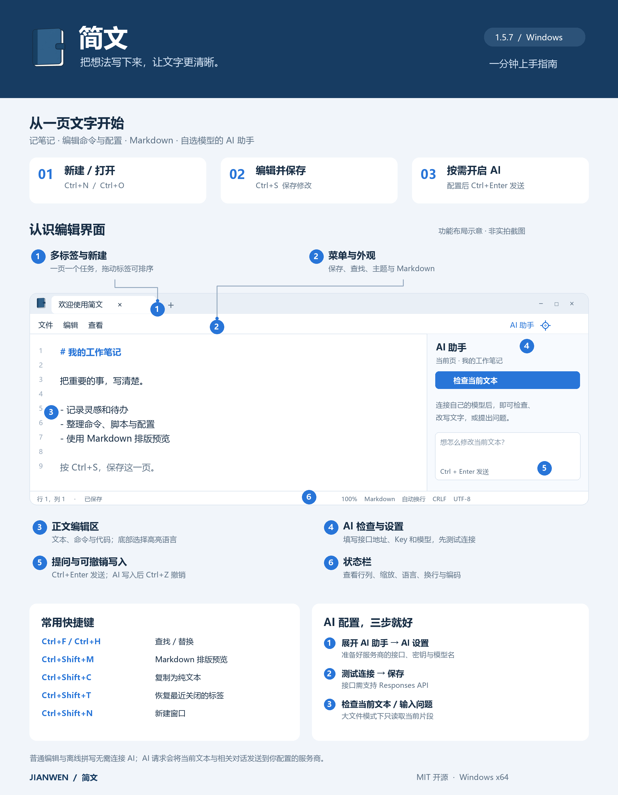

# 简文 1.5.7 使用指南

使用图是按 1.5.7 功能绘制的操作示意，演示内容不含个人资料，不是应用实拍截图。

## 安装与第一次打开

在 Releases 下载 Jianwen-1.5.7-Setup-x64.exe 并安装。免安装版请放到有写入权限的独立文件夹运行。系统需有 .NET Framework 4.8 和 Microsoft Edge WebView2 Runtime。

## 写作、保存和恢复

点击标签旁的 + 或按 Ctrl+N 新建。按 Ctrl+O 打开文件，按 Ctrl+S 保存，按 Ctrl+Shift+S 另存为。新标签按首行文字自动命名。退出时保留会话草稿，重新打开会恢复；重要文件仍建议主动保存到磁盘。

拖动标签可调整顺序，Ctrl+Tab 切换标签，Ctrl+Shift+N 新建窗口，Ctrl+Shift+T 恢复最近关闭的标签。每个窗口分别记住尺寸、位置和最大化状态。

## 查找与外观

按 Ctrl+F 查找，Ctrl+H 替换，Ctrl+G 跳转到行。从“查看”菜单切换主题、行号、换行，或进入“字体与外观”。使用 Ctrl+滚轮 缩放，Ctrl+0 恢复 100%。

底部状态栏显示行列、字符数、保存状态、缩放、高亮语言、换行和编码。切换高亮语言不会改变文件内容。

## Markdown

按 Ctrl+Shift+M，或进入“查看 → Markdown 排版预览”。预览开启时可使用标题、加粗、链接、列表等工具；再次使用快捷键可切回源码。文件可另存为 .md。

## AI 助手

1. 点击菜单右侧“AI 助手”展开侧栏，再点击侧栏的设置图标。
2. 填写服务商提供的接口地址、API Key、模型名，可设置助手名称和思考强度。
3. 点击测试连接，连接成功后保存。
4. 点击“检查当前文本”，或在输入框提出要求，按 Ctrl+Enter 发送。
5. 回复进行中可停止请求。AI 写入当前页后可按 Ctrl+Z 撤销。

接口使用 Responses API，程序会将地址规范化到 /responses。请使用明确支持该 API 的服务；仅支持 /chat/completions 的接口不一定可用。模型名称须与服务商一致。大文件模式只提供当前片段，不能据此推断完整文件。

AI 请求会把当前页文本和相关对话发送到你的服务商。未配置服务时，编辑器仍可正常编辑和保存文字。

## 复制、编码与大文件

普通复制支持在 Word / WPS 等应用中保留文字样式；Ctrl+Shift+C 复制纯文本。目标软件也会影响最终粘贴效果。

在“文件 → 另存为并选择编码”选择 UTF-8、UTF-8 BOM、UTF-16 LE/BE 或 GB18030。编辑菜单提供换行格式切换。打开超大文本时按片段编辑与保存，支持的单文件上限为 1 GiB。

## 常用快捷键

| 快捷键 | 操作 |
| --- | --- |
| Ctrl+N / Ctrl+O / Ctrl+S | 新建 / 打开 / 保存 |
| Ctrl+Shift+S | 另存为 |
| Ctrl+F / Ctrl+H / Ctrl+G | 查找 / 替换 / 跳转到行 |
| Ctrl+Z / Ctrl+Y | 撤销 / 重做 |
| Ctrl+W / Ctrl+Shift+T | 关闭标签 / 恢复关闭的标签 |
| Ctrl+Tab / Ctrl+Shift+Tab | 下一个 / 上一个标签 |
| Ctrl+Shift+N | 新建窗口 |
| Ctrl+Shift+M | Markdown 排版预览 |
| Ctrl+Shift+C | 复制为纯文本 |
| Ctrl+P | 打印 |
| Ctrl+Enter | 在 AI 输入框内发送消息 |
| Ctrl+0 | 恢复 100% 缩放 |

## 数据备份

关闭简文后复制 EXE 旁的 JianwenData 文件夹即可备份本地会话与设置。迁移到其他电脑或 Windows 账户时需重新填写 AI 密钥。
